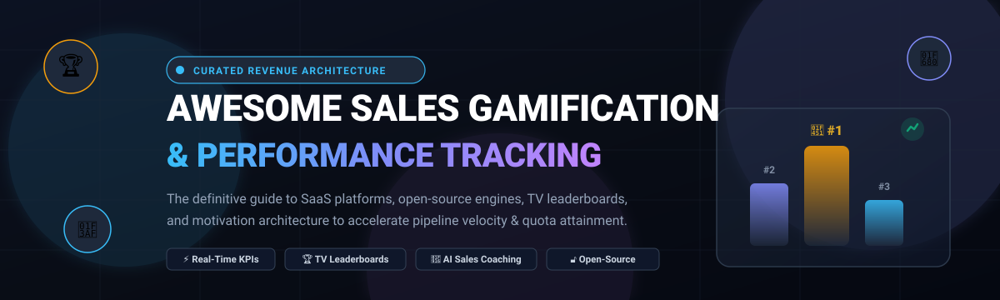

# 🏆 Awesome Sales Gamification & Performance Tracking 🚀

  <b>A battle-tested, curated index of world-class Sales Gamification engines, TV leaderboard displays, AI sales coaching platforms, and open-source performance frameworks.</b> 
  <i>Boost team morale, accelerate quota attainment, eliminate seller burnout, and scale pipeline visibility.</i>

🌟 **Star this repository if it helps power your sales engine!** 🌟

---

## 📋 Table of Contents

- [🌐 Sector Overview & Market Dynamics](#-sector-overview--market-dynamics)
- [🏢 Commercial SaaS Platforms](#-commercial-saas-platforms)
  - [🔍 SaaS Platforms Feature & Capability Breakdown](#-saas-platforms-feature--capability-breakdown)
- [🔓 Open-Source Software & Developer Frameworks](#-open-source-software--developer-frameworks)
  - [⚙️ Open-Source Ecosystem Breakdown](#-open-source-ecosystem-breakdown)
- [📊 Feature Comparison Matrix](#-feature-comparison-matrix)
- [💡 Buying Guide & Implementation Strategy](#-buying-guide--implementation-strategy)
- [⭐ Star History](#-star-history)
- [💖 Support & Sponsorship](#-support--sponsorship)
- [🤝 Contributing](#-contributing)
- [📄 License](#-license)

---

## 🌐 Sector Overview & Market Dynamics

The global gamification software sector is estimated at **$30+ billion**, with the dedicated sales gamification, incentive compensation, and sales performance management (SPM) sub-segment accounting for over **$4 billion** and projected to surpass **$14 billion** at a compound annual growth rate (CAGR) exceeding 20%. 

Market consolidation shows a **moderately fragmented** landscape rather than a winner-take-all monopoly:
- 🏢 **Ecosystem Suites:** Broad CRM ecosystem giants like Zoho and Salesforce integrate gamification and scorecard analytics natively into their multi-product bundles.
- 🎯 **Specialized SPM & Engagement Providers:** High-growth pure-play vendors (Centrical, SalesScreen, Ambition, Spinify) compete aggressively with deep TV broadcasting, AI-driven scenario coaching, fantasy leagues, and reward fulfillment networks.
- 🛡️ **Anti-"Winner-Take-All" Mechanics:** In sales team design, industry research confirms that "winner-take-all" contest setups cause disengagement among middle and lower-tier performers; modern platforms instead emphasize threshold goals, peer-to-peer duels, and milestone-based micro-rewards to engage the entire revenue team.

---

## 🏢 Commercial SaaS Platforms

The table below benchmarks leading SaaS sales gamification solutions, sorted in descending order by company scale (valuation / annual revenue / venture funding).

| 🏷️ Product | 📈 Company Scale (Valuation / Revenue / Funding) | 💰 Starting Tier Pricing | 🎁 Free Tier / Free Trial Limits | 🎯 Key Focus & Sales Integrations |
| :--- | :--- | :--- | :--- | :--- |
| **[Zoho Motivator](https://www.zoho.com/crm/motivator/)** | **~$12B–$15B** valuation (Zoho Corp ARR: ~$1.5B) | **$14/user/month** (bundled in Zoho CRM Standard; free in Zoho One / CRM Plus) | Free forever plan available (limited to 5 users, 1 KPI competition, company targets) & 15-day trial | Direct Zoho CRM native sync, TV channels, target scorecards, contest broadcasts |
| **[Centrical](https://centrical.com/)** | **$84M+** raised (incl. $39M Series D; ~$25M+ ARR) | **~$25/user/month** (flat annual user license + pooled AI credits) | ❌ No self-serve free forever plan; 30-day proof-of-concept / guided enterprise pilot | Enterprise frontline performance orchestration, AI roleplay, microlearning, gamified attach rates |
| **[SalesScreen](https://www.salesscreen.com/)** | **~$64M** valuation (~$8M ARR, $4M funding) | **$15/user/month** (Essentials tier, billed annually) | Free 30-day trial (Essentials tier: max 4 metrics, standard contests, unlimited TV screens) | Visual TV leaderboards, dynamic celebrations, integrated coin reward shop, battle duels |
| **[Ambition](https://ambition.com/)** | **~$50M–$100M** valuation ($21.2M funding, ~$15M ARR) | **~$19/user/month** (Starter tier; ~$6,840/yr base package) | ❌ No free forever plan; 14-day guided sandbox demo trial for qualified sales teams | Fantasy sports-style sales contests, manager 1-on-1 coaching cadences, Salesforce/HubSpot bi-directional sync |
| **[Hoopla](https://www.raydiant.com/hoopla/)** (by Raydiant) | **~$25M–$50M** valuation (Raydiant raised $50M+) | **$25/user/month** (Base engagement tier, billed annually) | 30-day fully functional free trial (requires guided demo setup; test contests & TV stream) | Digital signage TV leaderboards, instant sound/video trigger celebrations, Slack/Teams alerts |
| **[Arcade](https://arcade.co/)** | **~$15M–$25M** valuation ($6M funding, ~$10.6M ARR) | **~$15/user/month** (Frontline workforce package, annual agreement) | ❌ No free forever tier; 14-day pilot trial available for qualified multi-unit sales teams | Gamified retail & frontline sales, Tremendous prize redemptions, micro-incentive challenges |
| **[SmartWinnr](https://www.smartwinnr.com/)** | **Bootstrapped** (~$3.2M–$8M estimated ARR) | **$10/user/month** (AppExchange baseline tier, annual billing) | 30-day free trial (access to quizzes, leaderboard modules, challenge engine) | Blended gamification with daily knowledge reinforcement quizzes, compliance tracking, AI roleplay |
| **[LevelEleven](https://leveleleven.com/)** (Ascent Cloud) | **~$10M–$15M** valuation ($9.5M funding, ~$1M–$3M ARR) | **$45/user/month** (Motivate plan, billed annually) | 15-day AppExchange test drive trial environment (Salesforce sandbox deployment) | 100% Salesforce-native performance scorecards, pacing indicators, TV broadcast channel |
| **[Spinify](https://spinify.com/)** | **Self-funded / Bootstrapped** (~$2M–$3.5M ARR) | **$9/user/month** (Starter package, billed annually) | 14-day free trial (full leaderboard features, unlimited TV channels, Slack/Teams bots) | Octalysis psychological motivation, automated YouTube celebrations, real-time KPI scoreboards |

---

### 🔍 SaaS Platforms Feature & Capability Breakdown

#### 🏆 Zoho Motivator
* **🚀 Deployment Model:** CRM-native cloud add-on and suite component.
* **💪 Core Strengths:** Real-time data pipeline from Zoho CRM to TV screens, custom scorecards, and multi-metric competitions without additional connector maintenance.
* **🎯 Best Suited For:** Existing Zoho CRM and Zoho One users looking for turnkey gamification with zero API integration overhead.

#### 🧠 Centrical
* **🚀 Deployment Model:** Enterprise workforce performance intelligence OS.
* **💪 Core Strengths:** Integrates gamified milestone tracking with AI-generated roleplay simulations, adaptive microlearning, and frontline operational QA.
* **🎯 Best Suited For:** Large BPO contact centers, telecommunications, and retail sales networks with thousands of frontline reps.

#### 📺 SalesScreen
* **🚀 Deployment Model:** Standalone cloud platform with bidirectional CRM connectors.
* **💪 Core Strengths:** Cinematic TV broadcast leaderboards, real-time celebration popups with custom music/video clips, peer-to-peer battles, and an integrated rewards marketplace.
* **🎯 Best Suited For:** Mid-market to enterprise outbound sales development (BDR/SDR) and Account Executive teams using Salesforce or HubSpot.

#### 🏈 Ambition
* **🚀 Deployment Model:** Cloud sales coaching and performance management platform.
* **💪 Core Strengths:** Fantasy league brackets, rep scorecards, pacing goal trackers, and automated manager coaching cadences that tie directly into CRM closed-won pipeline.
* **🎯 Best Suited For:** Data-driven sales leadership teams looking to balance contest gamification with weekly structured coaching.

#### 📣 Hoopla (by Raydiant)
* **🚀 Deployment Model:** Cloud digital workplace signage and performance broadcasting.
* **💪 Core Strengths:** High-energy visual broadcasts on office monitors, mobile push celebration alerts, and customizable milestone animation clips.
* **🎯 Best Suited For:** Hybrid and in-office sales floors requiring continuous visual motivation on wall-mounted screens.

#### 🎮 Arcade (arcade.co)
* **🚀 Deployment Model:** Mobile-first frontline gamification and micro-learning platform.
* **💪 Core Strengths:** Threshold-based contests rewarding reps for beating historical averages; automated prize fulfillment (gift cards, physical goods) via Tremendous.
* **🎯 Best Suited For:** Distributed retail store networks, field sales, and telecommunications teams.

#### 💡 SmartWinnr
* **🚀 Deployment Model:** Mobile app and web-based gamified training platform.
* **💪 Core Strengths:** Blends sales contests and leaderboards with automated daily micro-quizzes, ensuring reps maintain up-to-date knowledge on product catalogs and pitch decks.
* **🎯 Best Suited For:** Regulated sales forces (pharma, financial advisory, insurance) that need verifiable product mastery alongside quota tracking.

#### ⚡ LevelEleven
* **🚀 Deployment Model:** 100% Salesforce AppExchange native application.
* **💪 Core Strengths:** Operates strictly within Salesforce data architecture. Zero data leaves your Salesforce tenant; features live TV broadcasts, goal pacing, and coaching notes.
* **🎯 Best Suited For:** Heavily regulated or security-conscious enterprises already standardized exclusively on Salesforce Sales Cloud.

#### 🏎️ Spinify
* **🚀 Deployment Model:** Cloud multi-channel leaderboard platform (TV, Slack, Teams, Mobile).
* **💪 Core Strengths:** Leverages the Octalysis gamification framework; rapid setup with pre-built leaderboard templates, personalized celebration videos, and tiered point ladders.
* **🎯 Best Suited For:** Fast-growing inside sales and agency teams wanting TV-driven leaderboards with minimal IT setup.

---

## 🔓 Open-Source Software & Developer Frameworks

The open-source landscape provides developer frameworks, gamification engines, and community modules to build custom sales tracking applications without recurring per-seat SaaS costs. 

Projects below are sorted in descending order by GitHub Stars_Count.

| 📦 Project | ⭐ GitHub_Stars | 💻 Primary Tech Stack | 📜 License | 🧩 Architecture & Gamification Mechanics |
| :--- | :--- | :--- | :--- | :--- |
| **[odoo/odoo](https://github.com/odoo/odoo)** |  | Python, JavaScript, PostgreSQL | LGPL-3.0 | Full open-source ERP/CRM suite with built-in `gamification` and `crm_gamification` modules providing sales targets, badges, and challenge goals |
| **[gitscrum-core/laravel-gitscrum](https://github.com/gitscrum-core/laravel-gitscrum)** |  | PHP (Laravel), Blade, MySQL | GPL-3.0 | Project and sprint performance management platform with built-in gamification mechanics, user points, levels, and milestone rewards |
| **[qcod/laravel-gamify](https://github.com/qcod/laravel-gamify)** |  | PHP (Laravel) | MIT | Drop-in gamification package for Laravel applications; reputation points, badge definitions, event triggers, and leaderboard rankings |
| **[cjmellor/level-up](https://github.com/cjmellor/level-up)** |  | PHP (Laravel) | MIT | Modular gamification system featuring experience points (XP), dynamic leveling algorithms, achievements, and real-time leaderboard tables |
| **[ActiDoo/gamification-engine](https://github.com/ActiDoo/gamification-engine)** |  | Python, PostgreSQL | MIT | Backend gamification platform (gengine) with REST API for achievements, progress ladders, time-based contests, and leaderboards |
| **[Meeds-io/meeds](https://github.com/Meeds-io/meeds)** |  | Java, PostgreSQL, Elasticsearch | LGPL-3.0 | Open-source digital workplace hub featuring community spaces, kudos recognition, quest systems, and gamified participation points |
| **[gstt/laravel-achievements](https://github.com/gstt/laravel-achievements)** |  | PHP (Laravel) | MIT | Pluggable achievement and milestone engine supporting multi-step progress, unlock criteria, and event listeners |
| **[trophyso/ui](https://github.com/trophyso/ui)** |  | TypeScript, React, Tailwind CSS | MIT | Open-source collection of reusable frontend gamification UI components including leaderboards, streak counters, badges, and challenge cards |
| **[isuru89/oasis](https://github.com/isuru89/oasis)** |  | Java, Redis, MySQL | Apache-2.0 | Event-driven Points, Badges, Milestones, and Leaderboards (PBML) engine inspired by StackOverflow badge architecture |
| **[jrmyward/honor](https://github.com/jrmyward/honor)** |  | Ruby (Rails), ActiveRecord | MIT | Lightweight Ruby on Rails gem providing points ledgers, leaderboard rankings, and achievement rewards |
| **[fvergaracl/GAME](https://github.com/fvergaracl/GAME)** |  | Python, FastAPI, PostgreSQL | MIT | Goals And Motivation Engine; adaptive microservice architecture for behavior-aware scoring, virtual coin conversions, and Keycloak auth |

---

### ⚙️ Open-Source Ecosystem Breakdown

#### 1. 🏢 Odoo Gamification Framework
* **🔗 Repository:** [odoo/odoo](https://github.com/odoo/odoo)
* **🛠️ How It Works:** Odoo includes a native `gamification` module in core ERP and CRM editions. Sales teams can create recurring challenges, assign automated goal evaluations (e.g., number of quotation leads created, invoiced revenue, confirmed sales orders), and award badges.
* **🎯 Best For:** Businesses running their operations on Odoo seeking an ERP-native sales motivation solution without external integrations.

#### 2. 📋 GitScrum Core
* **🔗 Repository:** [gitscrum-core/laravel-gitscrum](https://github.com/gitscrum-core/laravel-gitscrum)
* **🛠️ How It Works:** Combines agile project management with gamified task completion, points, and leaderboard standings for distributed execution teams.
* **🎯 Best For:** Cross-functional technical sales, solutions engineering, and implementation teams.

#### 3. 🚀 Laravel Gamify & Level-Up
* **🔗 Repositories:** [qcod/laravel-gamify](https://github.com/qcod/laravel-gamify) & [cjmellor/level-up](https://github.com/cjmellor/level-up)
* **🛠️ How It Works:** These packages provide ready-to-use Eloquent models and events for tracking user XP, badge unlocks, streak records, and dynamic leaderboards.
* **🎯 Best For:** Developers building bespoke internal sales dashboards or customer-facing portals using the Laravel framework.

#### 4. 🐍 ActiDoo Gamification Engine (gengine)
* **🔗 Repository:** [ActiDoo/gamification-engine](https://github.com/ActiDoo/gamification-engine)
* **🛠️ How It Works:** A dedicated Python-based engine providing REST endpoints for calculating complex progress curves, levels, and time-restricted tournament leaderboards.
* **🎯 Best For:** Engineering teams looking for a standalone gamification microservice to integrate via webhooks with their custom CRM or sales database.

#### 5. 🎨 Trophy UI
* **🔗 Repository:** [trophyso/ui](https://github.com/trophyso/ui)
* **🛠️ How It Works:** Pre-built React components designed with Tailwind CSS and Radix primitives for rendering clean sales scorecards, rank ladders, and achievement popups.
* **🎯 Best For:** Frontend engineers assembling custom real-time sales dashboards.

#### 6. 🎯 GAME (Goals And Motivation Engine)
* **🔗 Repository:** [fvergaracl/GAME](https://github.com/fvergaracl/GAME)
* **🛠️ How It Works:** Built on FastAPI and PostgreSQL, GAME offers rule-based evaluation of user actions, translating raw KPI metrics into points and redeemable coin balances.
* **🎯 Best For:** Teams wanting an open-source, API-first gamification backend capable of deploying via Docker and Kubernetes.

---

## 📊 Feature Comparison Matrix

| 🛠️ Platform | ☁️ Deployment Mode | 🔄 Sales-Specific CRM Connectors | 📺 TV Screen Broadcasting | ⚔️ Peer Battles / Head-to-Head | 🎁 Automated Reward Fulfillment | 🧑‍🏫 Integrated Coaching Cadence |
| :--- | :--- | :--- | :--- | :--- | :--- | :--- |
| **Zoho Motivator** | Cloud SaaS | ✅ Zoho CRM | ✅ Yes | ✅ Yes | ❌ (Target only) | ❌ Scorecards only |
| **SalesScreen** | Cloud SaaS | ✅ Salesforce, HubSpot, Leadx | ✅ Yes | ✅ Yes | ✅ Yes (Coin shop) | ✅ Add-on ($5/mo) |
| **Centrical** | Cloud SaaS | ✅ Salesforce, Zendesk, Genesys | ❌ Mobile/Desktop | ✅ Yes | ✅ Yes | ✅ AI-driven coaching |
| **Ambition** | Cloud SaaS | ✅ Salesforce, HubSpot | ✅ Yes | ✅ Yes (Fantasy league) | ❌ Manual vouchers | ✅ Built-in 1-on-1s |
| **Spinify** | Cloud SaaS | ✅ Salesforce, HubSpot, Pipedrive | ✅ Yes | ✅ Yes | ✅ Integrated rewards | ❌ Leaderboard focus |
| **Hoopla** | Cloud SaaS | ✅ Salesforce, Raydiant Signage | ✅ Yes | ✅ Yes | ❌ (Celebration only) | ❌ (Visuals only) |
| **LevelEleven** | Salesforce Native | ✅ Salesforce AppExchange | ✅ Yes | ✅ Yes | ❌ Partner integrations | ✅ Built-in cadence |
| **Odoo Gamification** | Self-Hosted / Cloud | ✅ Odoo CRM Native | ❌ Add-on required | ❌ Badges only | ❌ Manual badges | ❌ Goal evaluations |
| **ActiDoo (gengine)** | Self-Hosted Open-Source | ⚠️ Via REST API | ❌ Build custom UI | ⚠️ Via custom logic | ❌ Custom integration | ❌ Engine only |
| **GAME** | Self-Hosted Open-Source | ⚠️ Via FastAPI endpoints | ❌ Build custom UI | ⚠️ Custom rules | ⚠️ Virtual coins API | ❌ Engine only |

---

## 💡 Buying Guide & Implementation Strategy

When choosing between commercial SaaS and open-source gamification tools for your revenue organization, evaluate these criteria:

1. 🔄 **CRM & Data Pipeline Maturity:**
   - If your team relies on Salesforce and has strict data compliance requirements, **LevelEleven** or native **Salesforce AppExchange** configurations prevent external data transmission.
   - If using HubSpot or multi-CRM setups, tools like **SalesScreen** or **Ambition** provide turnkey bidirectional sync.
2. 📺 **Display Infrastructure (In-Office vs. Remote):**
   - In-office floor environments benefit substantially from **Hoopla**, **Spinify**, or **SalesScreen** displaying live TV streams and triggering sound effects when deals close.
   - Remote or hybrid teams thrive on Slack/Microsoft Teams notifications, mobile app leaderboards, and peer-to-peer recognition.
3. 🧠 **Contest Psychology & Incentive Design:**
   - Avoid strict top-performer-only prizes. Deploy threshold-based milestones (e.g., beating last quarter's outbound discovery rate) to keep lower and mid-tier representatives engaged.
4. ⚖️ **Build vs. Buy TCO:**
   - Building in-house using open-source engines (**gengine**, **GAME**, or **Laravel Gamify**) offers maximum customization and zero per-seat license costs, but requires ongoing frontend development, CRM webhook maintenance, and display UI upkeep.
   - Commercial SaaS platforms charge **$9–$50/seat/month**, but provide ready-to-use TV broadcasting, CRM integrations, and mobile applications on day one.

---

## ⭐ Star History

---

## 💖 Support & Sponsorship

Thank you for exploring this curated repository! If you find this guide valuable for your revenue operations, product research, or gamification stack, here are ways you can support the project:

- ⭐ **Star this repository** on GitHub to help others discover it.
- 🍴 **Fork the repo** and contribute additions, updates, or case studies.
- 📢 **Share this list** with your fellow sales leaders, RevOps engineers, and founders on LinkedIn, Twitter/X, and sales communities.
- ☕ **Buy a coffee & sponsor ongoing maintenance:** Support our open-source research and curate more tooling lists through the [GitHub Sponsor Dashboard](https://github.com/sponsors/ishandutta2007).

---

## 🤝 Contributing

We welcome contributions from the community! If you maintain or use an open-source gamification or sales performance project that should be indexed here:

1. 🍴 Fork this repository.
2. 🌿 Create a new branch: `git checkout -b add-my-project`.
3. 📝 Add your tool to the relevant table and breakdown section following alphabetical or star-count sorting rules.
4. 🚀 Open a pull request with a clear description of the project, stack, and active license.

---

## 📄 License

This repository and its curated contents are licensed under the [CC0 1.0 Universal (Public Domain)](LICENSE). Software tools and platforms referenced within this repository remain subject to their respective copyright holders and open-source or proprietary licenses.
